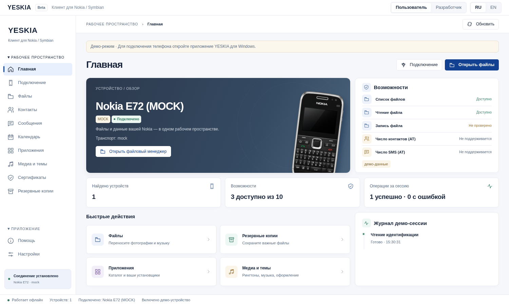
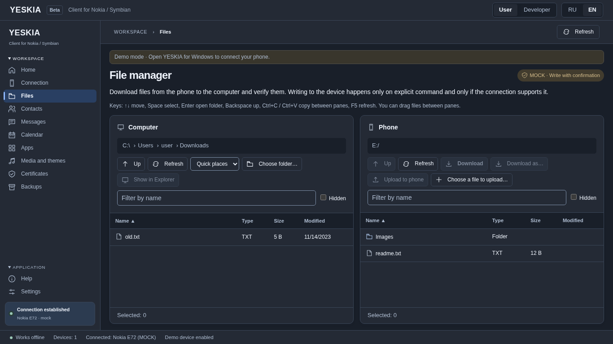
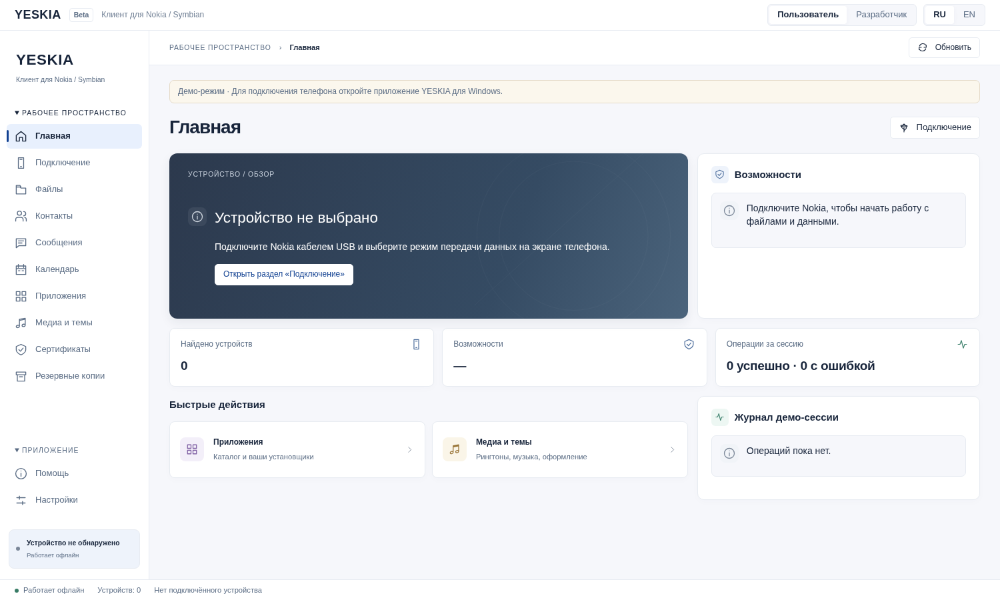

# Интерфейс YESKIA

Текущий интерфейс следует Windows 11 / Fluent-подобному направлению из
[issue #37](https://github.com/grayhex/YESKIA/issues/37). Nokia Blue `#124191`
сохранён; светлые/тёмные поверхности, компактные рабочие панели и Segoe UI
заменяют пастельный Soft UI. По уточнению владельца YESKIA теперь выводится
обычным текстом в стиле приложения, без графического логотипа. Модель
демо-устройства по умолчанию — **Nokia E72** в браузерном и Rust mock.
Предыдущее решение сохранено в [Soft UI Evolution](design/SOFT_UI.md).

## Реализация

- `styles/tokens.css`, `styles/app.css` — базовые компоненты и компоновка;
  `styles/fluent.css` — активные поверхности, типографика и состояния.
  `soft-ui.css` оставлен как исторический материал и не подключается.
- Светлая/тёмная тема определяется `prefers-color-scheme`. Анимации отключаются
  при `prefers-reduced-motion`. Переходы не меняют размеры элементов.
- Окно по умолчанию 1500×900, минимальное 960×600; сохранён штатный нативный titlebar Tauri/Windows
  с системными кнопками окна. Веб-шапка содержит текстовое название, режим и язык. Ниже находится
  компактная панель с текущим разделом и работающей командой обновления.
- Боковая навигация разделена на сворачиваемые группы рабочего пространства
  и приложения; порядок разделов соответствует превью. Стрелки/Home/End
  обходят видимые разделы; переход из другой страницы раскрывает нужную группу.
- Главная показывает выбранное подключённое или первое найденное устройство,
  его транспорт, матрицу возможностей и последние четыре операции сессии.
  Иллюстрация берётся из реестра моделей, неизвестная модель — нейтральная графика.
  Кнопки файлов/бэкапов появляются только для проверенных
  `available` возможностей; отсутствие матрицы не означает поддержку PC Suite.
  Плитки приложений и медиа открывают локальные инструменты и не запускают
  передачу на телефон. Синий/зелёный/фиолетовый/янтарный акценты повторяют
  макет в иконках, показателях и списках; графитовый градиент приглушён.
- Две файловые панели имеют независимые пути, переходы к предкам пути,
  сортировку имени/типа/размера/даты, фильтр, скрытые файлы и выделение.
  Escape снимает выделение. Заголовок таблицы закреплён, строки прокручиваются
  внутри панели. Переход по пути очищает выделение, корень транспорта сохраняется.
  Только чтение явно поясняется над панелями. Очередь, прогресс, отмена,
  подтверждение записи и разрешение коллизий используют существующий backend.
- При 1366×768 основные команды остаются видны, длинное содержимое прокручивается.
  При уменьшении рабочего пространства файловые и личные панели располагаются
  друг под другом; на узких окнах навигация переносится над содержимым.
- `i18n.tsx` и `workspaceCopy.ts` — RU/EN, включая подключение, сертификаты,
  личные данные, каталог и сообщения ошибок нативного адаптера.
- SVG-иконки используются в навигации, кнопках и файловых списках, вместо emoji.
- «Подключение» объединяет соединение с диагностикой. Подробные таблицы свёрнуты.
- Личные данные читаются с выбранного подключённого устройства. Полей Python,
  профиля Gammu и внешнего Bridge нет. Смена телефона/страницы отменяет чтение
  и удаляет старый снимок из страницы.
- Сертификат сначала проверяется, затем отдельное подтверждение показывает
  получателя и SHA-256. Телефон завершает установку после подтверждения пользователя.
  Передача не помечается как установленное доверие.
- Модальный диалог удерживает клавиатурный фокус, Esc отменяет действие,
  после закрытия фокус возвращается. Технические коды ошибок видны в режиме
  разработчика; обычный интерфейс показывает текст ошибки.

## Проверка

UI-тесты проверяют навигацию, обе локали, чтение/поиск/экспорт записей без Python,
подтверждение сертификата, native save dialog cancellation, отсутствие повторных
files.list при фоновом опросе, пакеты, файлы, копии, медиа и обновления.
Браузерная проверка: 1500×900, 1366×768, светлая/тёмная тема и reduced motion,
текстовое название YESKIA и загрузка иллюстрации E72.
Детали текущего прогона: [Fluent verification](screenshots/fluent/README.md).
Поэлементная сверка: [IMPLEMENTATION.md](design/windows11-fluent/IMPLEMENTATION.md).
`npm run ui:layout` воспроизводит проверки размеров, прокрутки и графики в Chromium;
проверка также запускается в CI.

Браузер вне Tauri показывает заметный демо-баннер; это проверка представления,
а не подключение телефона. Состояния модели/USB проверяются отдельно по
[аппаратному runbook](protocol/PERSONAL_WORKSPACE.md).

Происхождение изображений телефонов и прежнего логотипа: [ASSETS.md](ASSETS.md).
