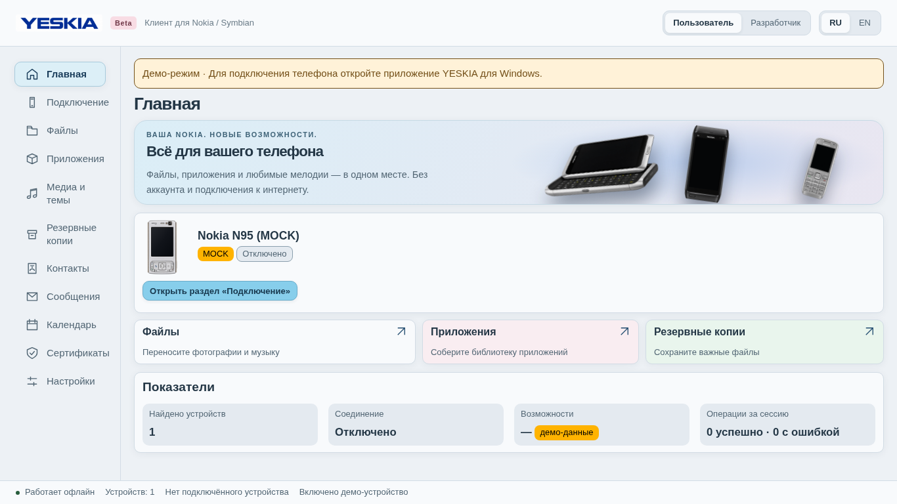
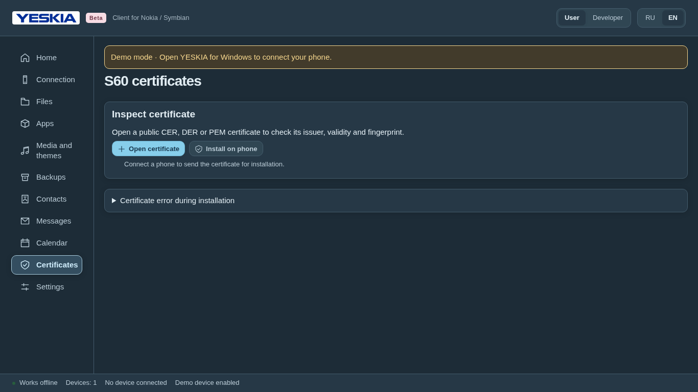

# Интерфейс YESKIA

Текущий дизайн — [Soft UI Evolution](design/SOFT_UI.md), предоставленный владельцем.
Он адаптирован к компактному настольному приложению: пастельные голубые, розовые и
зелёные акценты, мягкие поверхности и тени, читаемый тёмный текст, явные границы
контролов и фокус. Пастельный розовый не используется как основной цвет текста
на светлом фоне из-за низкого контраста. Исходный логотип YESKIA сохранён локально.

## Реализация

- `styles/tokens.css`, `styles/app.css` — базовые компоненты и компоновка;
  `styles/soft-ui.css` — активная палитра, поверхности, типографика и состояния.
- Светлая/тёмная тема определяется `prefers-color-scheme`. Анимации отключаются
  при `prefers-reduced-motion`. Переходы не меняют размеры элементов.
- Окно по умолчанию 1500×900. При 1366×768 основные начальные страницы и отчёт
  диагностики помещаются без внешнего скролла. Длинные списки прокручиваются
  внутри панелей; на маленьком окне/при увеличении масштаба сохраняется обычный
  скролл для доступа к содержимому.
- `i18n.tsx` и `workspaceCopy.ts` — RU/EN, включая подключение, сертификаты,
  личные данные, каталог и сообщения ошибок нативного адаптера.
- SVG-иконки используются в навигации, кнопках и файловых списках, вместо emoji.
- «Подключение» объединяет соединение с диагностикой. Подробные таблицы свёрнуты.
- Личные данные читаются с выбранного подключённого устройства. Полей Python,
  профиля Gammu и внешнего Bridge нет. Смена телефона/страницы отменяет чтение
  и удаляет старый снимок из страницы.
- Сертификат сначала проверяется, затем отдельное подтверждение показывает
  получателя и SHA-256. Телефон завершает установку после подтверждения пользователя.
  Передача не помечается как установленное доверие.
- Модальный диалог удерживает клавиатурный фокус, Esc отменяет действие,
  после закрытия фокус возвращается. Технические коды ошибок видны в режиме
  разработчика; обычный интерфейс показывает текст ошибки.

## Проверка

UI-тесты проверяют навигацию, обе локали, чтение/поиск/экспорт записей без Python,
подтверждение сертификата, native save dialog cancellation, отсутствие повторных
files.list при фоновом опросе, пакеты, файлы, копии, медиа и обновления.
Браузерная проверка: 1500×900, 1366×768, светлая/тёмная тема и reduced motion,
загрузка исходного логотипа, английские страницы без русских подписей.

Браузер вне Tauri показывает заметный демо-баннер; это проверка представления,
а не подключение телефона. Состояния модели/USB проверяются отдельно по
[аппаратному runbook](protocol/PERSONAL_WORKSPACE.md).

Происхождение изображений телефонов и логотипа: [ASSETS.md](ASSETS.md).
