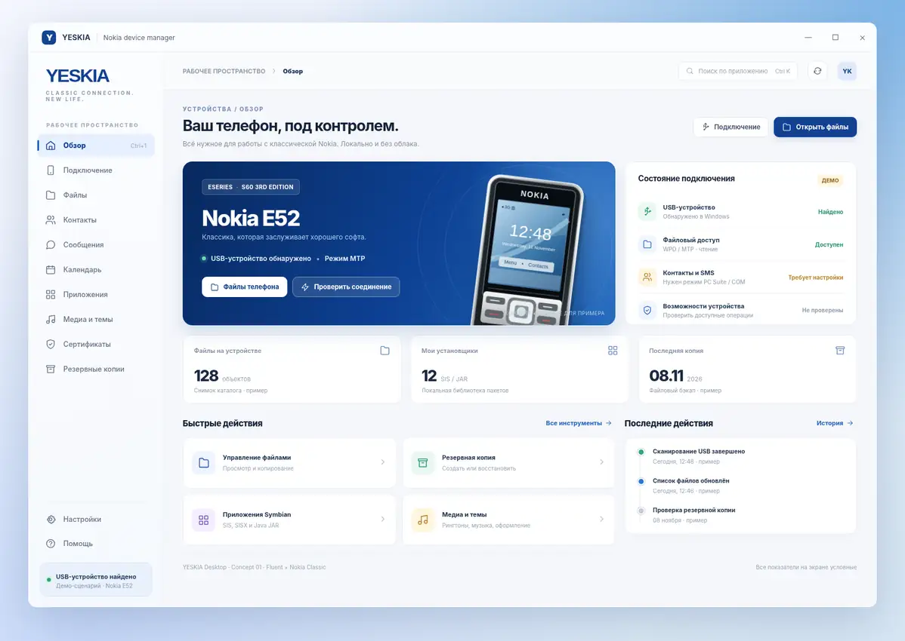
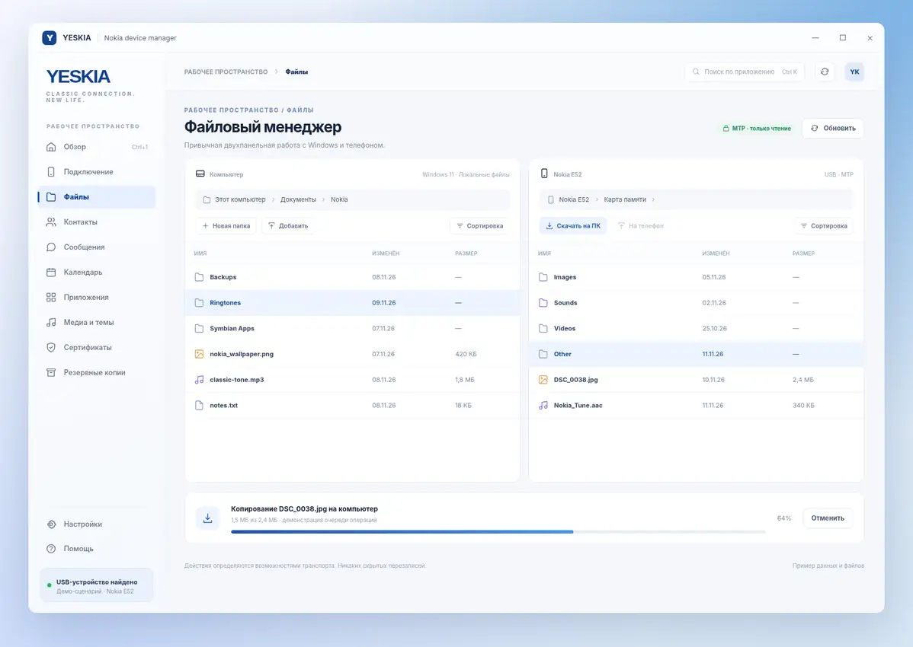

# YESKIA · Windows 11 Fluent concept

**Статус:** дизайн-референс и передача агенту, не готовая реализация интерфейса.  
**Основа:** существующее приложение Tauri 2 + React/TypeScript.  
**Визуальный код:** Nokia Classic Blue `#124191` × Windows 11 Fluent 2.

## Макеты

### Главная: устройство, подключение, полезные операции

### Файлы: полноценный двухпанельный менеджер

**[Открыть интерактивный HTML-прототип](prototype.html)**: вкладки «Обзор» и «Файлы» имеют самостоятельные макеты; другие разделы показывают общую структуру и навигацию. HTML работает локально без сборки и сети.

### Графика

- [Схематичная векторная Nokia E52](assets/e52-schematic.svg) из прототипа. Иллюстрация является дизайн-референсом, не официальным материалом Nokia.
- В реальном приложении брать **исходный фирменный логотип YESKIA** из `ui/src/assets/brand/yeskia-logo.png`, не копировать текстовую имитацию из макета.
- Реестр существующих изображений телефонов: `ui/src/phones/registry.ts`. Права на reference-based графику отмечены в `docs/ASSETS.md` как неподтверждённые, не расширять использование без решения владельца.

## Как интерпретировать макет

Это **визуальная концепция**, а не спецификация новых возможностей USB-протокола. Все названия файлов, цифры, прогресс передачи, USB-статусы и действия в HTML вымышлены для демонстрации компоновки. Не переносить их в рабочий интерфейс как реальные значения.

Ключевые решения:
1. Компактная нативно выглядящая оболочка Windows 11: title bar, боковая навигация, рабочий canvas, статусная строка.
2. Оригинальный синий Nokia как основной акцент, остальные поверхности спокойные; контрастные элементы вместо чрезмерной пастели Soft UI.
3. **Телефон как главный элемент обзорного экрана**; выбранная модель из реальных данных, либо честное empty state.
4. **Файлы прежде всего**: две панели компьютер/телефон, реальные режимы чтения/записи и явные ограничения транспорта, очередь операций.
5. В остальных разделах единая типографика, toolbar, поиск, таблицы, состояния загрузки/ошибок/отмены.
6. Пользовательский интерфейс должен оставаться **desktop-first**, не копировать веб-лендинг.

## Задание агенту

См. [AGENT_TASK.md](AGENT_TASK.md) и связанный issue. Требования важнее декоративных деталей макета: визуал улучшить, не ломая безопасность, бэкенд, реальную доступность операций или локальный характер приложения.

## Рекомендованные параметры

- Базовый размер окна 1500×900, обязательная проверка 1366×768, DPI/масштаб 100%, 150%, 200%.
- `Segoe UI Variable` с системным fallback, Unicode и RU/EN; умеренные радиусы около 8–14px.
- Светлая/тёмная тема по настройке Windows; контраст WCAG AA на обычных текстах и контролах.
- Состояния hover/focus/disabled/loading, клавиатура и системные диалоги Windows.
- Пустые и неподдерживаемые состояния важнее декоративной «подключено».
